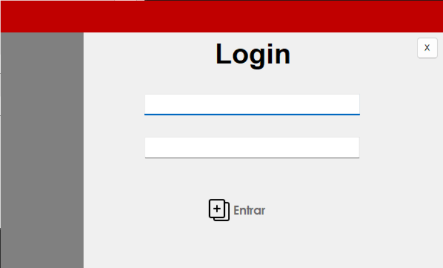
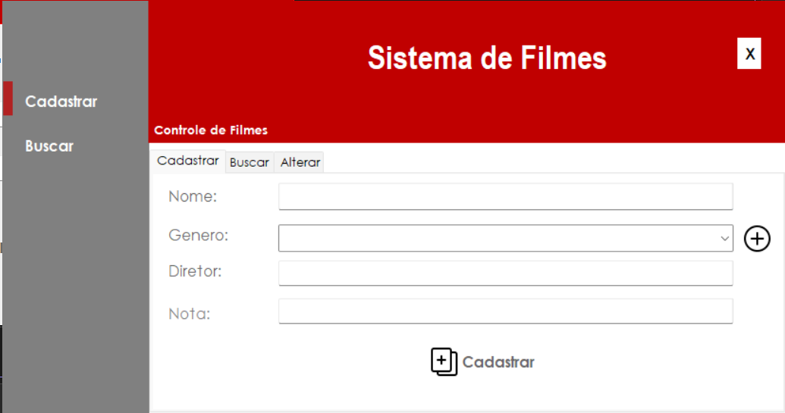
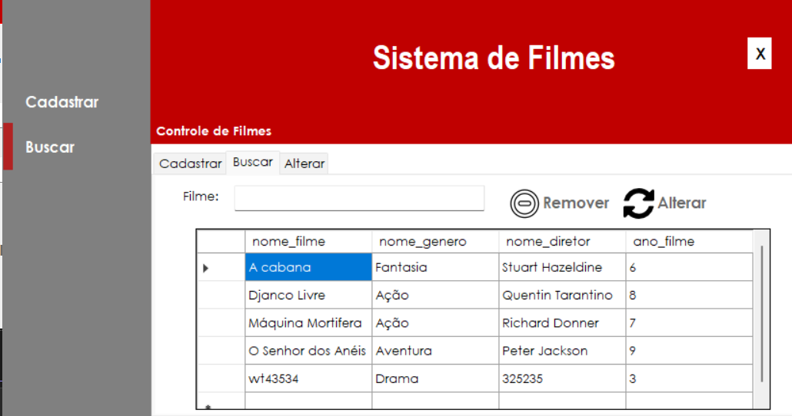
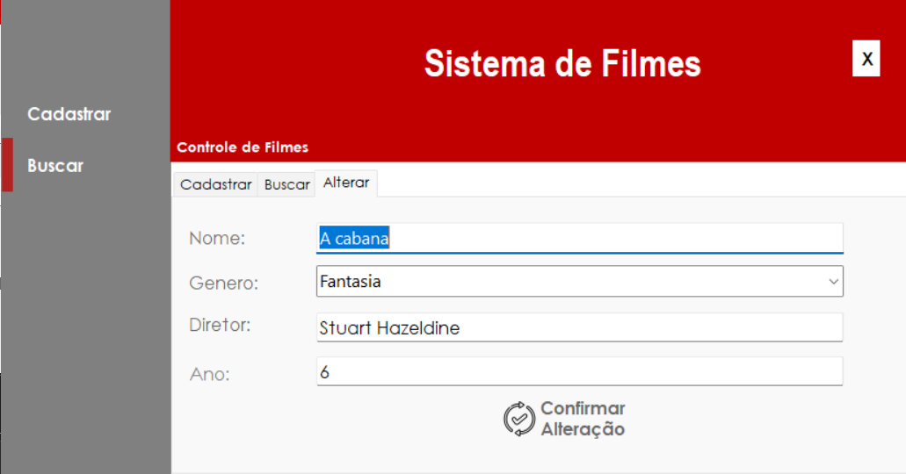
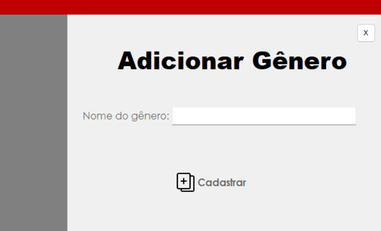

# Sistema de Cadastro de Filmes

O Sistema de Cadastro de Filmes é um aplicativo de desktop para Windows que permite organizar um catálogo de filmes. Após entrar com usuário e senha, é possível cadastrar filmes, consultar os registros pelo título, alterar informações e remover filmes. O sistema também permite cadastrar novos gêneros para usar no catálogo. Cada filme é registrado com nome, gênero, diretor e ano.

## Linguagem de programação e tecnologias

**C#** é a linguagem de programação principal do projeto. Ela é usada para ler os dados digitados, validar campos, executar as ações dos botões, navegar entre as janelas e solicitar operações ao banco de dados.

**Windows Forms (WinForms)** é a tecnologia usada para construir a interface gráfica. Ela fornece os formulários, botões, caixas de texto, listas de seleção, abas e a grade em que os filmes são exibidos. O projeto usa o **.NET Framework 4.7.2**, que fornece o ambiente de execução e as bibliotecas usadas pela aplicação.

**SQL** é a linguagem usada para definir as tabelas e escrever as rotinas de cadastro, consulta, alteração e exclusão. Essas rotinas são executadas no **MySQL**, o gerenciador que armazena os filmes, os gêneros e os usuários. O pacote NuGet **MySql.Data** permite que o programa em C# abra uma conexão com o MySQL, envie parâmetros e receba os resultados.

## Formulários do sistema

### 1. Tela de login — `FrmLogin`

É a primeira janela exibida quando o programa inicia. O usuário informa seu nome de usuário e sua senha e clica em **Entrar**. O aplicativo gera um hash SHA-256 da senha digitada e envia o nome de usuário e o hash ao procedimento `sp_consultarUsuario`, que procura um registro correspondente no banco de dados.

Quando o banco encontra o usuário, o programa abre a tela principal. Se a validação falhar, o sistema exibe a mensagem **Usuário ou senha incorretos!** e permite uma nova tentativa.

### 2. Tela principal — `Sistema`

É a janela que reúne as operações do catálogo. Quando ela é aberta, o programa busca no MySQL os gêneros disponíveis e os filmes cadastrados. As operações são organizadas nas abas **Cadastrar**, **Buscar** e **Alterar**.

#### Aba Cadastrar

Para registrar um filme, o usuário informa o nome do filme, seleciona um gênero, digita o nome do diretor e preenche o campo do ano. Ao clicar em **Cadastrar**, o programa verifica se o nome e o diretor foram preenchidos, se um gênero foi escolhido e se o ano é um número inteiro. Se o cadastro for concluído, o programa limpa os campos e atualiza a lista de filmes.

Na versão mostrada na captura, o campo do ano aparece com o rótulo **Nota**. O valor digitado nesse campo é salvo como **ano do filme**. O botão **+**, ao lado do gênero, abre a janela de cadastro de gêneros.

#### Aba Buscar

A aba **Buscar** exibe os filmes cadastrados com nome, gênero, diretor e ano. Conforme o usuário digita no campo **Filme**, a tela mostra os títulos que começam com o texto informado. Por exemplo, ao digitar `O Senhor`, a lista exibe títulos com esse início.

Para excluir um filme, o usuário seleciona o registro e clica em **Remover**. O programa pede confirmação antes de enviar a exclusão ao banco de dados. A operação usa o identificador do filme selecionado para localizar o registro. Depois da exclusão, a lista é carregada novamente.

#### Aba Alterar

Para editar um filme, o usuário seleciona uma linha na aba **Buscar** e clica em **Alterar**. O sistema abre a aba de edição com os campos preenchidos com os dados do registro. O usuário pode mudar o nome, o gênero, o diretor e o ano.

Ao clicar em **Confirmar Alteração**, o programa valida os valores e atualiza o registro no banco. Se a operação for concluída, o sistema retorna à aba **Buscar** e mostra a lista atualizada.

### 3. Tela de cadastro de gênero — `FrmAddGenero`

A janela **Adicionar Gênero** permite incluir uma categoria nova. O usuário digita o nome e clica em **Cadastrar**. O programa verifica se o campo foi preenchido, retira os espaços no início e no fim do texto e salva o nome no MySQL. Após o cadastro, uma mensagem confirma a operação e o campo é limpo para receber outro nome.

Ao clicar no **X**, o usuário retorna à janela principal. Os gêneros são carregados novamente, e o novo registro fica disponível na lista de seleção.

## Organização do código

**`Program.cs`** inicia a aplicação Windows Forms e abre `FrmLogin`. Os arquivos **`FrmLogin.cs`**, **`Sistema.cs`** e **`FrmAddGenero.cs`** definem como cada janela reage às ações do usuário. Os arquivos **`.Designer.cs`** correspondentes configuram os componentes visuais de cada formulário.

**`Filmes.cs`** define a classe que reúne os dados do filme durante o cadastro e a edição. **`ConectaBanco.cs`** centraliza a comunicação com o MySQL, como abrir a conexão, passar os parâmetros e receber os resultados. **`Bibliotecacs.cs`** contém o método que gera o hash da senha usado na consulta de login.

## Banco de dados

O banco `bancos_filmes` tem três tabelas. A tabela **`filmes`** guarda o nome, o identificador do gênero, o diretor e o ano de cada filme. A tabela **`generos`** guarda o identificador e o nome de cada gênero. A tabela **`usuarios`** guarda os nomes de usuário e os hashes consultados no login.

O campo `id_genero` associa cada filme a um gênero. Essa relação permite que vários filmes tenham o mesmo gênero. Quando o catálogo é carregado, o procedimento `sp_listaFilmes` consulta as tabelas de filmes e gêneros em conjunto para exibir o nome do gênero na tela.

As operações são executadas por procedimentos armazenados, que são rotinas SQL definidas no MySQL. Ao cadastrar um filme, por exemplo, o formulário valida os campos, reúne os dados em um objeto da classe `Filmes` e chama `ConectaBanco`. Essa classe envia os valores ao procedimento `sp_insereFilme`. Depois que o banco salva o registro, o programa atualiza a lista de filmes.

## Como executar o projeto

1. No Windows, use o Visual Studio com suporte a desenvolvimento para desktop em .NET e o pacote de desenvolvimento do **.NET Framework 4.7.2**.
2. Importe o arquivo `bancos_filmes.sql` em uma instância do MySQL 8. Ele contém a estrutura do banco `bancos_filmes` e os procedimentos usados pelo programa.
3. Abra o arquivo `SistemaCadastro.sln` no Visual Studio e restaure os pacotes NuGet.
4. Ajuste os dados da conexão com o MySQL no arquivo `ConectaBanco.cs`.
5. Execute o projeto e entre com um usuário cadastrado no banco.
